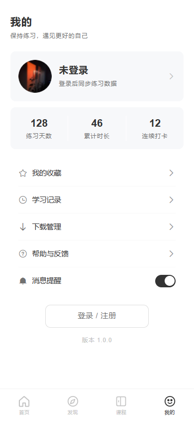

# 冥想 App · vue-h5

基于 Vue 3 + TypeScript + Vite 构建的移动端冥想练习应用，使用 Vant 组件库，内置本地 Mock 服务，覆盖首页、发现、课程、冥想详情与个人中心等核心页面。

## 页面截图

| 首页 | 发现 | 课程 |
| --- | --- | --- |
|  |  |  |

| 课程详情 | 冥想详情 | 我的 |
| --- | --- | --- |
|  |  |  |

| 登录 | | |
| --- | --- | --- |
|  | | |

## 技术栈

- Vue 3 + TypeScript
- Vite
- Vue Router
- Pinia（持久化存储）
- Vant 4
- Less
- Mock.js（本地 mock 中间件）

## 本地运行

```bash
pnpm install
pnpm dev
```
